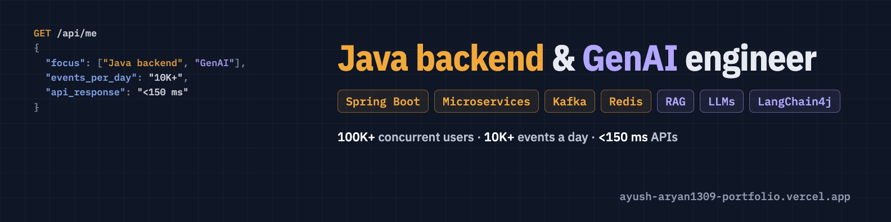

# Ayush Aryan

**Java backend engineer who also ships GenAI.** I build Spring Boot microservices and Kafka/Redis pipelines that run in production, and the LLM features – RAG, AI agents – that sit on top of them.

Software Engineer (SDE-1) at [Visionify](https://www.visionify.ai/) · Hyderabad, India · open to Java backend and GenAI roles

[**Portfolio + live RAG assistant**](https://ayush-aryan1309-portfolio.vercel.app) · [LinkedIn](https://www.linkedin.com/in/ayusharyan1309/) · [Email](mailto:ayusharyan1309@gmail.com)

---

### In production

- **Visionify** – I own the event-driven alerting platform that turns computer-vision detections into safety alerts on Email, Microsoft Teams and WhatsApp: **10K+ events a day, API responses under 150 ms**. I also lead PalletVision end to end: the CV model, the backend and the frontend.
- **EventStrat** – Spring Boot microservices for a global event-CRM platform with **100K+ concurrent users**, including a fault-tolerant Kafka ingestion pipeline handling 2K+ files of 50K+ rows per batch.

### GenAI projects

| Project | What it does | Built with |
| --- | --- | --- |
| [**OptiQuery**](https://github.com/ayusharyan1309/Database-Administrator-AI-Agent) | AI database-administrator agent. Ranks Postgres queries by total time burned, asks an LLM what is wrong, and proposes a fix with the evidence (execution plans, schema) attached so engineers can check it. | Java, Spring Boot, PostgreSQL, LLMs |
| [**RAG assistant**](https://github.com/ayusharyan1309/portfolio) | Answers recruiters' questions about my work: Workers AI embeddings, top-5 cosine retrieval, LLM answers streamed over SSE, swappable providers. [Try it live.](https://ayush-aryan1309-portfolio.vercel.app) | TypeScript, Cloudflare Workers, Groq / OpenAI / Gemini |
| [**JD Resume Tailor**](https://github.com/ayusharyan1309/chrome-extension) | Chrome extension that extracts a job description, scores the resume match and uses an LLM to tailor the resume, with LaTeX export. | React, OpenAI / Gemini |
| [**MedTrendz**](https://github.com/ayusharyan1309/MedTrendz-An-Ai-Medical-Help-App) | Play Store app that reads lab values from medical reports with GPT-4o-mini OCR and plots trends, plus medicine reminders. | Flutter, GPT-4o-mini |

### Backend projects

| Project | What it does | Built with |
| --- | --- | --- |
| [**Microservice Shop**](https://github.com/ayusharyan1309/MicroServices-ECommerce-APP) | Six Spring Boot services behind Spring Cloud Gateway, with Keycloak OAuth2, Kafka events and distributed tracing. | Java, Spring Cloud, Kafka, Keycloak, PostgreSQL, MongoDB |
| [**Real-time chat backend**](https://github.com/ayusharyan1309/chat-app-backend) | WebSocket (STOMP) messaging, Kafka events, Firebase auth, Liquibase migrations and S3 media. | Java 17, Spring Boot 3.5, MySQL |
| [**Wellness platform backend**](https://github.com/ayusharyan1309/Wellness-App-Backend) | Appointment booking where Redis slot management cut scheduling latency ~40% and ended double-booking; Kafka notifications, JWT auth. | Spring Boot, Redis, Kafka, Docker |

### Stack

**Backend** – Java · Spring Boot · Spring Cloud · Microservices · REST · gRPC · WebSockets · Hibernate/JPA  
**Messaging and data** – Apache Kafka · Redis · MySQL · PostgreSQL · MongoDB · Elasticsearch  
**GenAI** – RAG · LLM APIs (OpenAI, Gemini, Groq) · LangChain4j · LangChain · embeddings and vector search  
**Cloud and DevOps** – AWS (EC2, S3) · Docker · Jenkins CI/CD · Prometheus · Grafana  
**Also** – Python · TypeScript · Flutter

---

Hiring for Java backend or GenAI? [ayusharyan1309@gmail.com](mailto:ayusharyan1309@gmail.com)
